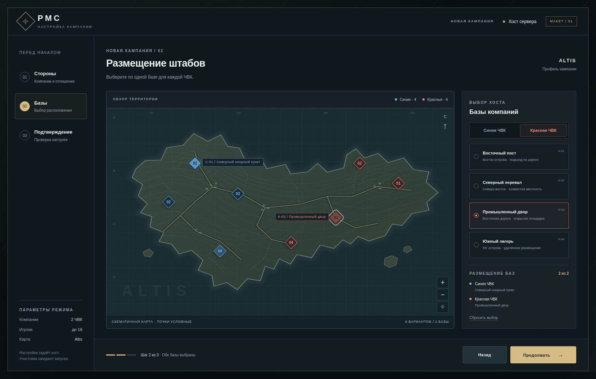

# PMC — самостоятельный режим Arma 3

**Ровно две ЧВК, до 16 игроков суммарно, PvE и противостояние компаний.**
Синяя компания официально приглашена правительством, красная работает в интересах
бизнеса. На старте они нейтральны. Армия и полиция поддерживают синих, зелёные —
общий противник. Хост выбирает по одной базе из четырёх вариантов каждой ЧВК:
всего восемь точек, две действующие базы.

Проект развивается **самостоятельно, без обязательной зависимости от LifeSim**.
Прежний аддон, его релизы, планы и аудиты перенесены в архив и больше не используются
как действующая основа.

## С чего начать команде

- [Актуальный вектор развития F2](docs/standalone/DEVELOPMENT_DIRECTION_RU.md).
- [Дорожная карта и критерии приёмки](docs/standalone/ROADMAP_RU.md).
- [Подробные правила сторон и выбора баз](docs/standalone/FACTIONS_AND_SETUP_RU.md).
- [Интерактивный макет стартовых настроек](docs/standalone/ui-preview/setup-preview.html)
  и [его отчёт](docs/standalone/ui-preview/README_RU.md).
- [Разбор трёх референсов](docs/standalone/REFERENCES_RU.md).
- [Отчёт обновления репозитория](docs/standalone/REPOSITORY_UPDATE_RU.md).

Макет — отдельный HTML: скачайте файл и откройте в браузере. Предпросмотр чата
может блокировать JavaScript; GitHub показывает исходный HTML, а не работающую страницу.

## Что действительно готово

| Материал | Состояние |
| --- | --- |
| Стенды S1 (отношения) и S2 (стейт-машина) 0.2.0 alpha 1 | Собственный мод, три тестовые миссии и консоль отношений; без LifeSim/CBA |
| Модель двух компаний и восьми точек | Согласованная спецификация; игровой реализации ещё нет |
| Стартовое меню F1-UI1 | Работающий браузерный макет с условной картой |
| Полная кампания, казна, контракты, снабжение и персонал | Дальнейшая реализация по дорожной карте |

**S1 создавался для исследования 1/2/3 компаний.** Эти тестовые конфигурации
сохранены для сравнения; будущая кампания рассчитана ровно на две ЧВК. Стенд
ещё не содержит нового стартового меню, правительства и восьми проверенных баз.
Его ZIP не выдаётся за новую игровую сборку по правилам F2. Проверки Arma не было.

- [Техническая основа и исходники](standalone/README.md).
- [Готовый архив 0.2.0 со стендом S2](standalone/dist/PMC_Standalone_0.2.0_s2_alpha1.zip) и
  [исходники](standalone/dist/PMC_Standalone_0.2.0_s2_alpha1_sources.zip);
  [Override GDD](docs/standalone/OVERRIDE_GDD_STATE_MACHINE_RU.md) и
  [разбор с решениями](docs/standalone/STATE_MACHINE_DECISIONS_RU.md).
- Прежняя сборка S1 0.1.2: [архив](standalone/dist/PMC_Standalone_0.1.2_s1_alpha1.zip),
  [исходники](standalone/dist/PMC_Standalone_0.1.2_s1_alpha1_sources.zip): миссии
  встроены в мод; [аудит и исправления 0.1.1](standalone/docs/AUDIT_0.1.1_RU.md);
  [результаты игровых прогонов](standalone/docs/GAME_RESULTS_RU.md).
- Прежняя сборка: [S1 0.1.1](standalone/dist/PMC_Standalone_0.1.1_s1_alpha1.zip).
- Прежняя сборка: [S1 0.1.0](standalone/dist/PMC_Standalone_0.1.0_s1_alpha1.zip),
  [исходники](standalone/dist/PMC_Standalone_0.1.0_s1_alpha1_sources.zip).
- [Отчёт S1](standalone/docs/S1_REPORT_RU.md) и [игровой чек-лист](standalone/docs/GAME_CHECKLIST_RU.md).
- [История текущего направления](CHANGELOG.md).

## Архив — больше не используется

- [Указатель архива](archive/README.md).
- [Прежний LifeSim PMC: код, релизы, исходная 0.6.3, документы и аудиты](archive/lifesim-pmc-unused/STATUS_RU.md).
- [Устаревшая концепция на 1–3 ЧВК и прежний PDF](archive/standalone-planning-v1-unused/README.md).
- [Проверка сохранности всех 147 ранее отслеживаемых файлов](archive/PRESERVATION.json).

Каждый этап получает русский отчёт: что сделано, почему, проверки, ограничения
и файлы. Затем пользователь передаёт исходники Claude для независимого аудита
и после исправлений проверяет результат в игре. Программные проверки и макет
не означают подтверждённого поведения ИИ или интерфейса в Arma.
