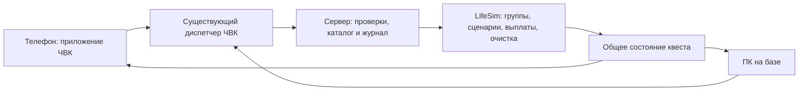

# Квесты ЧВК: проект интеграции с LifeSim 0.10.1

Исторический проект для обсуждения, 19 октября 2026 года. Актуальная реализация
десяти контрактов 0.5.0 описана в [CONTRACTS_RU.md](CONTRACTS_RU.md), её связь
с оригиналом — в [NATIVE_INTEGRATION.md](NATIVE_INTEGRATION.md). Ниже сохранены
первоначальные предложения, включая варианты, которые не вошли в реализацию.

Основа проекта — исходники
оригинального LifeSim 0.10.1, соответствующие функции RU beta 3 и PMC 0.3.1.
По следующему запросу пользователя в **0.4.0** реализован отдельный узкий
прототип [«Устранить цель»](TEST_CONTRACT_RU.md). В нём удалось использовать фазу
`end` без обёртки над `coopEnd`; новые контракты 0.5.0 используют узкую обёртку,
чтобы платить владельцу ЧВК вместо штатного деления награды.

Подтверждённое требование: один контракт должен допускать выполнение **одним
игроком или группой**, с одинаковыми функциями в телефоне и ПК. В первом варианте
предлагается сохранить штатный размер группы: **1–4 реальных игрока**.

## 1. На что действительно можно опереться

| Подсистема | Проверенные функции | Что важно для ЧВК |
|---|---|---|
| Перевозки и поставки | `jobAccept`, `jobCollect`, `jobDeliver`, `jobCheck`, `jobPublish` | Исполнитель связан с UID; доставка меняет экономику, выдаёт деньги и репутацию. Повторно начислять награду аддоном нельзя. |
| Групповые операции | `coopAccept`, `coopTick`, `coopEnd`, `coopJob_escort`, `coopJob_rescue`, `coopJob_sling` | Готовы транспорт, задачи AI, прогресс, частичный успех, распределение денег и очистка объектов. |
| Группа исполнителей | `crewOf`, `crewDo`, `crewPublish` | Одна группа на игрока; приглашения, лидер, максимум 4 участника. Группа временная. |
| Штатная компания | `companyOf`, `companySave`, `companyPublish` | Постоянные участники и общий банк; это существующая компания LifeSim, с её условиями создания. |
| Работа охранником | `festDo`, `festTick`, `festPay`, `festEnd` | Есть полноценная охрана фестиваля с оплатой времени и поимкой вора. Нужен действующий фестиваль. |
| Недвижимость и склад | `ALS_houses`, `ALS_owned`, `canUse`, `houseFloor`, `bizGet`, `bizStore`, `bizTake`, `bizPublish` | База и товары остаются штатными. Обычная складская система отказывается принимать ящики, помеченные `ALS_job`. |
| Обучение | `tutStart`, `tutState`, `tutCheck`, `tutEv` | У персонажа один штатный учебный маршрут `tut_<uid>`. Для цепочки ЧВК нужен собственный журнал, чтобы сохранить обучение выбранной профессии. |
| Сохранения | `dbLoading`, `dbGet`, `dbSet`, `dbSave`, `worldSave` | Дополнительные записи хранятся в БД текущего мира/слота. Нативные `ALS_jobs` и `ALS_coopJobs` создаются заново при запуске. |
| Закон | `lawInit`, `lawKilled`, существующие метки NPC | Штатный конвой уже использует метки нападающих; правила преступлений и полиции сохраняются. Лицензия ЧВК не заменяет оружейные/военные лицензии. |

В оригинале несколько самостоятельных механизмов заданий. Универсального API
«зарегистрировать квест и автоматически получить сохранение, интерфейс и выплаты»
нет. ЧВК нужен небольшой слой каталога, журнала и связи с этими механизмами.

`ALS_fnList` загружается из `fnlist.sqf` в `XEH_preInit.sqf`. Именно его читают
реестры кооперативных сценариев, случайных встреч и событий перевозки. Одна новая
функция `ALSPMC_fnc_*` в `CfgFunctions` не попадает в эти реестры автоматически.
Для первых контрактов предлагается использовать существующие виды `escort`
и `rescue`, сохраняя их имена и штатные связи с другими системами.

## 2. Как обеспечить одного игрока и группу

У `coopAccept` нет общего запрета на одного исполнителя: он проверяет наличие
группы, её лидера и поле `min` конкретного предложения. Штатные сценарии предлагают
`min = 2`. Группа из одного человека — допустимое нативное состояние: такой
реестр создаёт сам `crewDo` перед принятием приглашения вторым игроком.

Предлагаемое поведение:

1. Каталог ЧВК строит предложение через исходный сценарий `offer`. Маршрут,
   транспортные требования и базовый бюджет определяет LifeSim. Для предложения
   ЧВК задаётся `min = 1`; обычные предложения LifeSim сохраняют свои условия.
2. Если игрок уже лидер группы, используется эта группа. Её состав и права
   остаются штатными. Если у него уже идёт групповая операция, новый запуск
   недоступен по обычному правилу LifeSim.
3. Если группы нет, при принятии контракта создаётся штатная группа из одного
   исполнителя. У `crewDo` нет отдельной команды создания пустой/одиночной группы,
   поэтому потребуется небольшой серверный регистратор с тем же форматом
   `id/leader/members/job`, общим счётчиком `ALS_crewSeq` и `crewPublish`.
   Это отдельное дополнение аддона, а не существующий вызов LifeSim.
4. Автоматически созданная одиночная группа отмечается как принадлежащая этому
   запуску. После операции её можно убрать, только если она всё ещё одиночная,
   в ней нет новой операции и никто не присоединился. Пользовательские группы
   аддон не расформировывает.
5. Участник существующей группы принимает контракт через её лидера. Аддон
   не переносит его молча в другую группу. Для отдельного соло-контракта сначала
   используется штатный выход из группы.

Предложения ЧВК хранятся отдельно от штатной доски. При подтверждении на сервере
одно проверенное предложение получает ID из `ALS_coopSeq`, метку
`alspmcQuestId` и добавляется в список предложений своей группы непосредственно
перед вызовом `coopAccept`. При отказе удаляется только добавленная запись.
При успехе LifeSim сам регистрирует операцию и очищает предложения группы.
Фоновое обновление каталога не меняет маршрут/цену уже показанного предложения:
действуют срок годности и версия предложения.

Далее работают **исходные** `coopAccept → coopTick → coopJob_* → coopEnd`.
Операция находится в настоящем `ALS_coopJobs`; её `kind` остаётся `escort`
или `rescue`. Штатные навигация, ACE-действия, новости и приложение группы видят
эту же операцию. Второй тикер движения конвоя или второй расчёт оплаты не нужны.

Для фиксации результата потребуется серверная обёртка `coopEnd`: для обычных
операций она ровно один раз вызывает сохранённую исходную функцию; для операций
с меткой ЧВК дополнительно закрывает журнал и сохраняет результат. Она не платит
деньги поверх штатной награды. Обёртка должна сохранять аргументы и возвращаемое
значение и учитывать другие ранее установленные обёртки.

## 3. Предлагаемые первые квесты

| Квест | Задача игрока | Основа и ограничения |
|---|---|---|
| «Постановка ЧВК на учёт» | Иметь настоящую лицензию, название и действующую базу | Проверка существующих данных. Уже выполненные условия засчитываются; повторной покупки нет. Это вводный этап с открытием контрактов. |
| «Подготовка штаба» | Доставить выбранные припасы на склад базы | Штатные товары, покупка и `bizStore`. Для первой версии — разовый этап по наличию запасов; изъятие и возврат тех же товаров не должны выдавать повторные награды. |
| «Сопровождение конвоя» | Прибыть к машинам, сопровождать и довести грузовики до клиента | Готовый `coopJob_escort`; 1–4 исполнителя. Сохраняются штатные движение, засада, ожидание охраны и частичная оплата за прибывшие машины. |
| «Поисково-спасательный контракт» | Найти пострадавших и доставить их в порт; при возможности отбуксировать лодку | Готовый `coopJob_rescue`; требуется подходящая собственная лодка/вертолёт у исполнителей. Сохраняются вместимость и штатный бонус за буксировку. |
| «Охрана мероприятия» | Нести службу на действующем фестивале и задерживать карманников | `festDo/festTick/festPay`; один игрок или несколько охранников. Это отдельный адаптер: штатная оплата индивидуальна, а журнал ЧВК объединяет участие. |

Рекомендуемый первый рабочий прототип — **сопровождение конвоя**. Он проверяет
одиночный и групповой режим на одном готовом сценарии, обе панели управления,
выплату, отмену и историю. Остальные типы добавляются после проверки этого цикла.
Вводные этапы можно показывать рядом, автоматически отмечая уже сделанное.

Пока предлагается сохранить штатные бюджеты операций. Цена 1 € относится к
ранее согласованным тестовым лицензии и базе. Баланс наград, уровни ЧВК и штрафы
нужно обсуждать отдельно; изменять эти величины одновременно с первым подключением
движка заданий не требуется.

«Охрана склада/территории» может стать следующим собственным сценарием поверх
штатных недвижимости, NPC, AI и закона. Готовой универсальной миссией охраны
произвольного здания её считать нельзя. Аналогично, одиночную перевозку VIP
наземным транспортом нельзя просто назвать существующим вертолётным VIP-рейсом.

## 4. Телефон, ПК и сервер

В обоих интерфейсах: **«Доступные»**, **«Активный контракт»**, **«История»**.
Карточка показывает заказчика, цель, требования, маршрут, состав исполнителей,
общий бюджет и текущую схему выплаты. Действия: принять, отметить цель на карте,
посмотреть этапы, отменить с подтверждением. Для конвоя/спасения выполнение
определяет серверный сценарий; нажатие кнопки завершения не является доказательством
успеха.

Используется существующее пространство `a: alspmc`, например операция `quest`
с действием `accept/cancel/status`, ID, версией предложения и токеном ответа.
Нужны расширения белого списка и разбора аргументов в `phoneMsg/phoneDo`.
ПК передаёт тот же запрос через `desktopDo`, сохраняя проверку физического
терминала. Дополнительный `JSDialog`-обработчик не добавляется.

В общее `ALSPMC_phoneState` добавляется раздел `quests`, а ПК получает ту же
проекцию данных. Штатные `phone.set`, «Работа», «Рынок», «Гараж», «Наследие»
и маршрутизация их команд сохраняются. Прогресс берётся из нативной операции,
журнал принадлежит ЧВК. Открытие телефона или ПК не создаёт копию контракта.

Все участники видят общий контракт в приложении ЧВК своего телефона, даже
если у помощника нет собственной лицензии ЧВК. Помощник не получает права
переименовывать чужую ЧВК или управлять её недвижимостью. Работа за ПК требует
существующего права доступа к базе; принятие участия в контракте его не выдаёт.

## 5. Права и деньги

- Для запуска первой версии: основатель ЧВК с настоящей лицензией и действующей
  базой, являющийся одиночным исполнителем или лидером своей группы.
- Помощники приглашаются штатной системой группы; покупать каждому лицензию
  на создание собственной ЧВК не требуется.
- UID, группа, состав, бюджет, условия и результат определяются сервером.
  Используется проверка владельца RPC `requestAllowed` и повторная проверка
  прав/свободного слота при принятии. Цена и список исполнителей от клиента
  не принимаются как достоверные.
- Состав на выплату фиксирует `coopAccept`. Присоединившиеся позже могут
  помогать по штатным правилам, но доли этой операции не получают. Это нужно
  показывать до старта и при присоединении.
- У каждой ЧВК и каждой группы в первом варианте одна активная операция.
  Обычные задания LifeSim продолжают действовать по своим правилам и ограничениям.
- При отмене используется единственный штатный путь завершения с нулевой долей.
  Проверка состояния и завершение выполняются без переключения планировщика,
  чтобы два нажатия не вызвали `coopEnd` дважды. Завершённый ID повторно не закрывается.

Для кооперативных контрактов выплату делает **только `coopEnd`**:

- Один исполнитель получает бюджет с учётом результата в свой штатный банк.
- Группа получает штатное разделение общей суммы, с исходными округлениями.
- Если все первоначальные исполнители состоят в одной штатной компании и её
  настройка `jobsTo` включена, сумма поступает в её банк и журнал.
  LifeSim проверяет эту настройку при завершении.

У нынешней ЧВК есть название, основатель и база. Отдельный штатный банковский
счёт компании ей ещё не создавался. Поэтому обещать выплату «на счёт ЧВК» для
каждого игрока пока нельзя: это либо личный банк, либо уже созданная обычная
компания LifeSim. Условия её создания сохраняются.

Репутацию ЧВК и открытие следующих контрактов можно хранить в журнале аддона.
Они не заменяют репутацию городов и не дают оружейных/военных лицензий.
Штатные бонусы начисляют только те исходные подсистемы, где они предусмотрены:
например, кооперативный `coopEnd` не вызывает `payMods`, поэтому второй раз
применять ночную надбавку к такой выплате не нужно.

## 6. Сохранения, выход игроков и отключение

Предлагается дополнительный ключ **`alspmc_quests_v1`** в той же БД мира/слота.
В нём: собственная версия схемы, постоянный счётчик экземпляров, этапы ЧВК,
результаты и ограниченная история операций. Организация связывается с UID
основателя; смена названия и покупка другой базы не создают новую историю.

Экземпляр содержит ID ЧВК, ID/версию шаблона, начальную базу, UID заказавшего
контракт, исходный состав исполнителей, состояние и причину завершения,
ссылку на нативную операцию текущего запуска и отметку расчёта награды.
Нативный числовой ID и номер группы не являются постоянным ID: после перезапуска
счётчики LifeSim начинают отсчёт снова. Нужны собственный ID и идентификатор
запуска. Ссылки на объекты, юниты, группы и счётчики `time/serverTime` между
запусками не сохраняются как действительные ссылки и сроки.

Политика первого варианта:

| Событие | Предлагаемое поведение |
|---|---|
| Закрыли телефон/ПК | Операция продолжается на сервере. |
| Один игрок вышел, остальные в группе остаются | Действуют нативные правила группы; операция может продолжаться. После возвращения может потребоваться штатное приглашение. |
| Вышел последний участник | Штатный `coopTick` завершает операцию при пустой группе; переносить её через выход последнего игрока первая версия не обещает. |
| Смерть/возрождение | Сохраняются нативные условия конкретного сценария; дополнительно проверяются смена тела, живой исполнитель и отсутствие повторного начисления. Единый новый штраф за смерть пока не предлагается. |
| Перезапуск мира/сервера | История, этапы и выплаченные результаты остаются. Незаконченная нативная операция помечается «Прервана перезапуском», без новой выплаты и нового штрафа ЧВК. Доступен новый экземпляр контракта. |
| Продажа базы во время внешней операции | Штатная продажа остаётся доступной. Начатый конвой/спасение завершается по нативным правилам; запуск новых контрактов требует действующей базы. Условия снабжения проверяются для конкретного склада. |
| Аддон отключён при следующем запуске | LifeSim загружается штатно; дополнительные записи остаются в БД. Возвращение аддона не воспроизводит уже выплаченные операции. |
| Повреждён журнал ЧВК | Защита `dbLoading` сохраняет запись на диске. Новые квесты блокируются отдельно от лицензии, базы, ПК и штатных заданий. |

На старте и при завершении запись журнала фиксируется через штатный `dbSave`.
Для помеченных кооперативных операций обёртка завершения должна сохранить
нативные изменения денег и отметку результата в одном снимке БД, после выполнения
исходного `coopEnd`. Каждую секунду сохранять профиль ради полосы прогресса не нужно.
Подтверждённый результат не восстанавливается повторным вызовом функции выплаты.

Сохранение работающего конвоя с AI, повреждениями, маршрутом и группой между
запусками — отдельная большая задача. В исследованном коде оригинала такой
возможности нет; обещание полного восстановления потребовало бы отдельного
согласованного формата и проверок.

## 7. Этапы реализации

1. Каталог/журнал и одинаковые экраны телефона/ПК; чтение уже выполненных
   вводных условий. Выделенная готовность квестового сервиса.
2. Один помеченный контракт конвоя: одиночная группа, существующая группа,
   запуск через `coopAccept`, наблюдение нативного прогресса и один `coopEnd`.
3. История, отмена, сохранение, перезапуск и защита от двух одновременных запросов.
4. Игровая проверка с одним игроком и с группой; затем морское спасение.
5. Отдельные адаптеры фестивальной охраны и складского этапа; далее обсуждение
   новых сценариев охраны, сложности и репутации.

Код сценариев LifeSim в аддон не копируется. Используются функции установленного
оригинала или RU beta 3. Проверяется наличие нужных функций и поддерживаемая версия;
несовместимый адаптер блокируется отдельно, с понятным статусом. Расширение на
другую версию LifeSim проверяется заново.

## 8. Проверки и доказательства исследования

В отдельном исследовательском запуске SQF-VM исполнены настоящие `crewOf`,
`coopAccept`, `coopTick`, `coopEnd`, `companyOf`, `moneyGet/moneyAdd`, функции БД
и сохранения компании. Пройдено **13 утверждений с оригиналом и 13 с RU beta 3**:
одного изменения `min` без группы недостаточно; группа с одним UID исполнителя
принимает `min=1`; обычное `min=2` остаётся обязательным; параллельная операция
не принимается; сольная/групповая/корпоративная выплата выполняется штатно,
следующий тик не выдаёт повторной награды.

Сценарий, сетевые публикации и отдельные неподдерживаемые команды были тестовыми
адаптерами. Это подтверждает жизненный цикл и расчёт в исследованных функциях;
создание реальной группы в Arma, AI-конвой, засада, сохранение профиля, ACE и
совместная игра этим экспериментом не проверены. Игровая сборка не изменялась.

Обязательные проверки при реализации:

- Соло и группы из 2–4 игроков; существующая группа, чужой лидер, поздний вход,
  выход лидера и последнего участника.
- Один экземпляр контракта при подтверждении с двух панелей/двух клиентов;
  повторное завершение, отмена во время завершения, устаревшее предложение.
- Личный банк, разделение награды, `jobsTo`, частичный успех и отсутствие
  дополнительного денежного начисления аддоном.
- Обычная операция без метки ЧВК проходит через исходный `coopEnd` без изменений.
- Работа/рынок/гараж/наследие и штатная группа продолжают отправлять команды
  и получать обновления; проверки включают результат нажатия.
- Маршрут, штатная засада, законность действий, гибель грузовиков, заблокированная
  дорога, уничтожение транспорта спасателей, очистка NPC/объектов.
- Смена базы и названия, повреждённый ключ БД, сохранение/загрузка и отключение
  аддона; отсутствие незаработанной награды после перезапуска.

Опорные исходные файлы: `als_main/XEH_preInit.sqf`, `XEH_postInit.sqf`,
`functions/fn_crewDo.sqf:12`, `fn_coopAccept.sqf:4`, `fn_coopTick.sqf:1`,
`fn_coopEnd.sqf:1`, `fn_coopJob_escort.sqf:1`, `fn_coopJob_rescue.sqf:1`,
`fn_festDo.sqf:1`, `fn_festPay.sqf:1`, `fn_tutStart.sqf:1`,
`fn_bizStore.sqf:1`, `fn_dbSet.sqf:1`, `fn_dbSave.sqf:1`.
